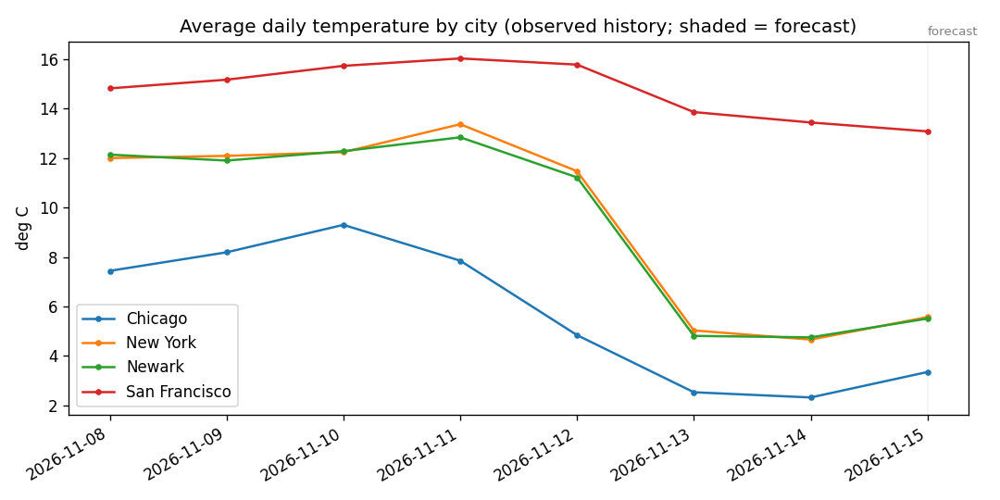

# Weather Warehouse




A small but real data engineering pipeline: hourly weather for four U.S. cities
flows from the [Open-Meteo](https://open-meteo.com/) API (free, no key) into a
local [DuckDB](https://duckdb.org/) warehouse with layered models, data quality
checks, and an auto-generated dashboard.

## Architecture

```
Open-Meteo API
     |
     v
raw_weather_hourly      append-only, idempotent loads (dedupe on city+hour)
     |
     v
stg_hourly (view)       typed, renamed, sanity-filtered
     |
     v
mart_daily_city         per-city daily summary: avg/min/max temp,
                        total precipitation, max wind, hours observed
     |
     v
quality checks ------>  null temps, implausible values, future rows, sparse days
     |
     v
reports/dashboard.md + avg_temp_by_city.png
```

Tracked cities: Newark, New York, Chicago, San Francisco.

## Quickstart

```bash
pip install -r requirements.txt
python scripts/daily_update.py   # ingest, load, test quality, build dashboard
python -m pytest                 # offline test suite (in-memory DuckDB)
```

`daily_update.py` exits non-zero if any data quality check fails, so a bad
ingest is loud instead of silent. Re-runs are idempotent: already-loaded
city/hour rows are skipped. The latest dashboard lives at
[reports/dashboard.md](reports/dashboard.md); forecast days are shaded on the
chart so observed history and forecasts are never confused.

## Why DuckDB

Embedded, zero-ops, and speaks great SQL - the same layered-model pattern
(raw -> staging -> marts) used with Snowflake/BigQuery/dbt, but runnable on a
laptop in seconds.
