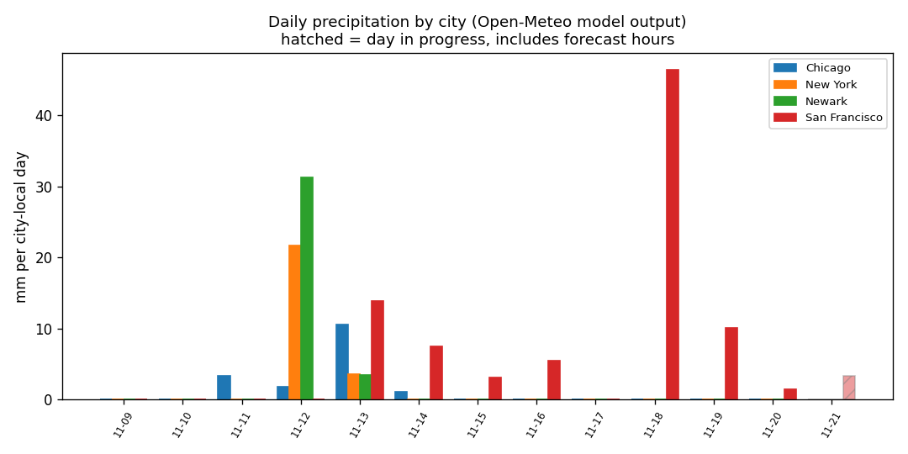

# Weather Warehouse - daily dashboard

Generated 2026-11-21 20:04 UTC.

| city | day | avg_temp_c | min_temp_c | max_temp_c | total_precip_mm | max_wind_kmh | hours_observed |
| --- | --- | --- | --- | --- | --- | --- | --- |
| Chicago | 2026-11-21 | 12.53 | 7.2 | 20.2 | 0.0 | 16.0 | 24 |
| New York | 2026-11-21 | 12.28 | 8.1 | 19.0 | 0.0 | 12.1 | 24 |
| Newark | 2026-11-21 | 11.77 | 6.7 | 18.8 | 0.0 | 12.8 | 24 |
| San Francisco | 2026-11-21 | 9.06 | 6.4 | 11.4 | 3.3 | 19.1 | 24 |
| Chicago | 2026-11-20 | 11.73 | 5.5 | 19.0 | 0.0 | 17.1 | 24 |
| New York | 2026-11-20 | 13.37 | 7.3 | 21.3 | 0.0 | 9.5 | 24 |
| Newark | 2026-11-20 | 12.92 | 5.6 | 21.7 | 0.0 | 11.2 | 24 |
| San Francisco | 2026-11-20 | 10.15 | 8.0 | 13.2 | 1.4 | 10.9 | 24 |
| Chicago | 2026-11-19 | 11.13 | 6.0 | 18.6 | 0.0 | 20.8 | 24 |
| New York | 2026-11-19 | 10.98 | 5.9 | 18.6 | 0.0 | 8.6 | 24 |
| Newark | 2026-11-19 | 10.61 | 3.7 | 19.9 | 0.0 | 9.1 | 24 |
| San Francisco | 2026-11-19 | 10.85 | 8.8 | 12.7 | 10.1 | 15.9 | 24 |
| Chicago | 2026-11-18 | 7.84 | 2.6 | 15.5 | 0.0 | 18.4 | 24 |
| New York | 2026-11-18 | 10.6 | 5.1 | 18.4 | 0.0 | 9.3 | 24 |
| Newark | 2026-11-18 | 10.43 | 3.1 | 19.3 | 0.0 | 10.5 | 24 |
| San Francisco | 2026-11-18 | 11.58 | 10.4 | 13.6 | 46.4 | 29.3 | 24 |
| Chicago | 2026-11-17 | 5.49 | 0.5 | 12.5 | 0.0 | 11.3 | 24 |
| New York | 2026-11-17 | 8.38 | 3.1 | 14.8 | 0.0 | 11.3 | 24 |
| Newark | 2026-11-17 | 8.37 | 2.2 | 15.3 | 0.0 | 11.8 | 24 |
| San Francisco | 2026-11-17 | 10.46 | 7.1 | 15.2 | 0.0 | 10.0 | 24 |
| Chicago | 2026-11-16 | 4.27 | -0.4 | 10.8 | 0.0 | 11.8 | 24 |
| New York | 2026-11-16 | 7.31 | 2.1 | 14.0 | 0.0 | 18.2 | 24 |
| Newark | 2026-11-16 | 7.31 | 1.9 | 13.9 | 0.0 | 17.8 | 24 |
| San Francisco | 2026-11-16 | 11.94 | 9.1 | 14.8 | 5.5 | 9.2 | 24 |
| Chicago | 2026-11-15 | 3.52 | -0.7 | 9.2 | 0.0 | 9.2 | 24 |
| New York | 2026-11-15 | 6.52 | 3.6 | 10.8 | 0.0 | 19.9 | 24 |
| Newark | 2026-11-15 | 6.48 | 3.8 | 10.4 | 0.0 | 22.1 | 24 |
| San Francisco | 2026-11-15 | 12.95 | 11.3 | 15.1 | 3.1 | 14.4 | 24 |
| Chicago | 2026-11-14 | 2.32 | -0.7 | 6.9 | 1.1 | 16.1 | 24 |
| New York | 2026-11-14 | 4.66 | 3.0 | 6.8 | 0.0 | 20.5 | 24 |

## Heat / cold exposure (current window)

Hours at or above 30C / at or below 0C and degree-hours beyond each threshold. Illustrative thresholds, not clinical guidance.

| city | heat hours | cold hours | heat degree-hours | cold degree-hours |
| --- | ---: | ---: | ---: | ---: |
| Chicago | 0 | 17 | 0.0 | 6.0 |
| New York | 0 | 0 | 0.0 | 0.0 |
| Newark | 0 | 0 | 0.0 | 0.0 |
| San Francisco | 0 | 0 | 0.0 | 0.0 |

## Unusual days

Completed days only: daily average temperature vs the city's other days (|z| >= 2). Informational: weather, not a data-quality failure.

| city | day | avg temp C | z-score |
| --- | --- | ---: | ---: |
| Chicago | 2026-11-20 | 11.73 | 2.02 |
| New York | 2026-11-14 | 4.66 | -2.0 |

## Precipitation

Model output in mm over the window; the current day includes forecast hours.

| city | total mm | wet days (>=1 mm) |
| --- | ---: | ---: |
| San Francisco | 91.1 | 8 |
| Newark | 34.7 | 2 |
| New York | 25.3 | 2 |
| Chicago | 16.7 | 4 |

## City leaders, 2026-11-20 (latest day complete in every city)

Model output, not station readings.

- Warmest high: Newark (21.7 C)
- Coldest low: Chicago (5.5 C)
- Wettest: San Francisco (1.4 mm)
- Windiest: Chicago (17.1 km/h)

## Severe-weather days

Daily rain >= 10 mm or wind >= 50 km/h. Illustrative thresholds, not official weather alerts. Values are Open-Meteo model output in mm and km/h per city-local day, not gauge observations; a day still in progress includes forecast hours.

| city | day | precip mm | max wind km/h | why | day status |
| --- | --- | ---: | ---: | --- | --- |
| San Francisco | 2026-11-19 | 10.1 | 15.9 | heavy rain | complete |
| San Francisco | 2026-11-18 | 46.4 | 29.3 | heavy rain | complete |
| Chicago | 2026-11-13 | 10.5 | 26.7 | heavy rain | complete |
| San Francisco | 2026-11-13 | 13.8 | 21.9 | heavy rain | complete |
| New York | 2026-11-12 | 21.7 | 24.5 | heavy rain | complete |
| Newark | 2026-11-12 | 31.3 | 30.1 | heavy rain | complete |

Data: [Open-Meteo](https://open-meteo.com/) hourly forecast API (past days are model `past_days` output, not observations).
