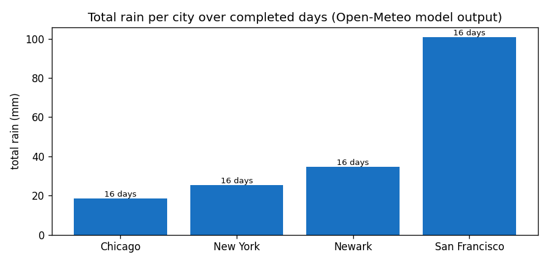
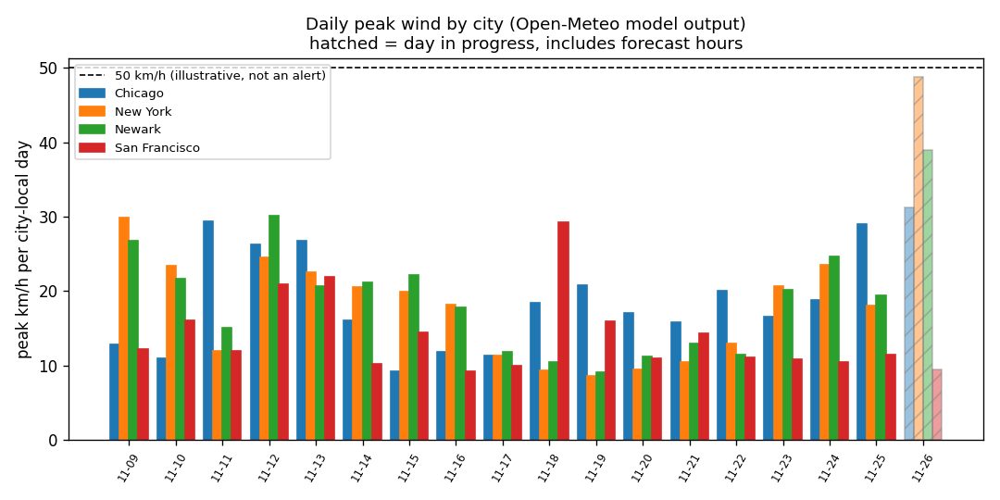

# Weather Warehouse - daily dashboard

Generated 2026-11-26 15:04 UTC.

| city | day | avg_temp_c | min_temp_c | max_temp_c | total_precip_mm | max_wind_kmh | hours_observed |
| --- | --- | --- | --- | --- | --- | --- | --- |
| Chicago | 2026-11-26 | 5.51 | 4.1 | 6.9 | 8.0 | 31.2 | 24 |
| New York | 2026-11-26 | 7.17 | 5.8 | 10.6 | 52.0 | 48.8 | 24 |
| Newark | 2026-11-26 | 6.61 | 4.6 | 10.4 | 46.4 | 39.0 | 24 |
| San Francisco | 2026-11-26 | 12.43 | 10.1 | 16.0 | 0.0 | 9.5 | 24 |
| Chicago | 2026-11-25 | 3.34 | 0.7 | 5.4 | 0.0 | 29.0 | 24 |
| New York | 2026-11-25 | 3.47 | -0.1 | 5.9 | 0.0 | 18.1 | 24 |
| Newark | 2026-11-25 | 3.49 | -0.3 | 6.9 | 0.0 | 19.4 | 24 |
| San Francisco | 2026-11-25 | 13.15 | 10.6 | 15.9 | 3.3 | 11.4 | 24 |
| Chicago | 2026-11-24 | 1.35 | -1.8 | 4.5 | 0.0 | 18.8 | 24 |
| New York | 2026-11-24 | 6.8 | 2.1 | 10.0 | 0.0 | 23.5 | 24 |
| Newark | 2026-11-24 | 7.12 | 2.6 | 10.1 | 0.0 | 24.6 | 24 |
| San Francisco | 2026-11-24 | 11.52 | 7.9 | 14.9 | 5.0 | 10.4 | 24 |
| Chicago | 2026-11-23 | 1.32 | -1.1 | 5.5 | 0.0 | 16.6 | 24 |
| New York | 2026-11-23 | 15.39 | 10.2 | 20.9 | 0.0 | 20.6 | 24 |
| Newark | 2026-11-23 | 15.54 | 10.5 | 21.5 | 0.0 | 20.2 | 24 |
| San Francisco | 2026-11-23 | 9.25 | 5.5 | 13.0 | 0.0 | 10.8 | 24 |
| Chicago | 2026-11-22 | 9.15 | 2.7 | 13.3 | 1.8 | 20.0 | 24 |
| New York | 2026-11-22 | 13.73 | 12.2 | 15.4 | 0.0 | 12.9 | 24 |
| Newark | 2026-11-22 | 13.4 | 11.3 | 15.5 | 0.0 | 11.5 | 24 |
| San Francisco | 2026-11-22 | 10.14 | 7.7 | 12.1 | 0.0 | 11.1 | 24 |
| Chicago | 2026-11-21 | 12.69 | 7.2 | 20.1 | 0.0 | 15.8 | 24 |
| New York | 2026-11-21 | 12.79 | 8.1 | 19.0 | 0.0 | 10.5 | 24 |
| Newark | 2026-11-21 | 12.23 | 6.7 | 19.2 | 0.0 | 13.0 | 24 |
| San Francisco | 2026-11-21 | 9.53 | 6.4 | 12.1 | 8.0 | 14.3 | 24 |
| Chicago | 2026-11-20 | 11.73 | 5.5 | 19.0 | 0.0 | 17.1 | 24 |
| New York | 2026-11-20 | 13.37 | 7.3 | 21.3 | 0.0 | 9.5 | 24 |
| Newark | 2026-11-20 | 12.92 | 5.6 | 21.7 | 0.0 | 11.2 | 24 |
| San Francisco | 2026-11-20 | 10.15 | 8.0 | 13.2 | 1.4 | 10.9 | 24 |
| Chicago | 2026-11-19 | 11.13 | 6.0 | 18.6 | 0.0 | 20.8 | 24 |
| New York | 2026-11-19 | 10.98 | 5.9 | 18.6 | 0.0 | 8.6 | 24 |

## Heat / cold exposure (current window)

Hours at or above 30C / at or below 0C and degree-hours beyond each threshold. Illustrative thresholds, not clinical guidance.

| city | heat hours | cold hours | heat degree-hours | cold degree-hours |
| --- | ---: | ---: | ---: | ---: |
| Chicago | 0 | 19 | 0.0 | 20.3 |
| New York | 0 | 3 | 0.0 | 0.2 |
| Newark | 0 | 3 | 0.0 | 0.8 |
| San Francisco | 0 | 0 | 0.0 | 0.0 |

## Unusual days

Completed days only: daily average temperature vs the city's other days (|z| >= 2). Informational: weather, not a data-quality failure.

| city | day | avg temp C | z-score |
| --- | --- | ---: | ---: |
| Newark | 2026-11-25 | 3.49 | -2.11 |
| New York | 2026-11-25 | 3.47 | -2.09 |
| Chicago | 2026-11-21 | 12.69 | 2.04 |

## Precipitation

Model output in mm over the window; the current day includes forecast hours.

| city | total mm | wet days (>=1 mm) |
| --- | ---: | ---: |
| San Francisco | 104.1 | 10 |
| Newark | 81.1 | 3 |
| New York | 77.3 | 3 |
| Chicago | 26.5 | 6 |

## City leaders, 2026-11-25 (latest day complete in every city)

Model output, not station readings.

- Warmest high: San Francisco (15.9 C)
- Coldest low: Newark (-0.3 C)
- Wettest: San Francisco (3.3 mm)
- Windiest: Chicago (29.0 km/h)

## Source freshness

Last successful Open-Meteo fetch per city (empty or failed fetches do not count). The latest hour is normally ahead of now because the feed includes forecast hours.

| City | Last successful fetch | Age (h) | Failed fetches since | Latest hour held |
| --- | --- | ---: | ---: | --- |
| Chicago | 2026-11-26 10:04:55.579922 | 0.0 | 0 | 2026-11-26 23:00:00 |
| New York | 2026-11-26 10:04:55.579922 | 0.0 | 0 | 2026-11-26 23:00:00 |
| Newark | 2026-11-26 10:04:55.579922 | 0.0 | 0 | 2026-11-26 23:00:00 |
| San Francisco | 2026-11-26 10:04:55.579922 | 0.0 | 0 | 2026-11-26 23:00:00 |

## Dry-day streaks (rain under 1 mm)

Consecutive completed days below 1 mm of rain. Model output; illustrative, not a drought measure.

| City | Current streak (days) | Longest streak (days) |
| --- | ---: | ---: |
| Chicago | 3 | 7 |
| New York | 12 | 12 |
| Newark | 12 | 12 |
| San Francisco | 0 | 4 |

## Warmest and coldest completed days

By daily average temperature, within the current data window only. Model output, not climate records.

| City | Warmest day | Avg C | Coldest day | Avg C | Days compared |
| --- | --- | ---: | --- | ---: | ---: |
| Chicago | 2026-11-21 | 12.69 | 2026-11-23 | 1.32 | 17 |
| New York | 2026-11-23 | 15.39 | 2026-11-25 | 3.47 | 17 |
| Newark | 2026-11-23 | 15.54 | 2026-11-25 | 3.49 | 17 |
| San Francisco | 2026-11-11 | 16.03 | 2026-11-23 | 9.25 | 17 |

## Week over week temperature

Mean daily average temperature, latest 7 completed days vs the 7 before. Two short windows, model output.

| City | Latest 7 days (C) | Previous 7 days (C) | Change (C) |
| --- | ---: | ---: | ---: |
| Chicago | 7.24 | 4.4 | +2.84 |
| New York | 10.93 | 7.71 | +3.22 |
| Newark | 10.76 | 7.62 | +3.13 |
| San Francisco | 10.66 | 12.86 | -2.20 |

## Degree days (base 18 C)

Heating degree days sum how far each completed day's average fell below 18 C; cooling degree days the reverse. Illustrative base, model output, current window only.

| City | Days | Heating degree days | Cooling degree days |
| --- | ---: | ---: | ---: |
| Chicago | 17 | 199.1 | 0.0 |
| New York | 17 | 137.8 | 0.0 |
| Newark | 17 | 140.3 | 0.0 |
| San Francisco | 17 | 94.5 | 0.0 |

## Wettest completed days

Model output, current window only.

| City | Day | Precip (mm) |
| --- | --- | ---: |
| San Francisco | 2026-11-18 | 46.4 |
| Newark | 2026-11-12 | 31.3 |
| New York | 2026-11-12 | 21.7 |
| San Francisco | 2026-11-13 | 13.8 |
| Chicago | 2026-11-13 | 10.5 |

## Windiest completed days

Maximum hourly wind speed. Model output, current window only.

| City | Day | Max wind (km/h) |
| --- | --- | ---: |
| Newark | 2026-11-12 | 30.1 |
| New York | 2026-11-09 | 29.9 |
| Chicago | 2026-11-11 | 29.4 |
| San Francisco | 2026-11-18 | 29.3 |
| Chicago | 2026-11-25 | 29.0 |

## Day-to-day temperature volatility

Mean absolute change in daily average temperature between consecutive completed days. Model output, current window only.

| City | Day pairs | Mean change (C) | Largest swing (C) | On |
| --- | ---: | ---: | ---: | --- |
| Chicago | 16 | 1.99 | 7.83 | 2026-11-23 |
| New York | 16 | 2.11 | 8.59 | 2026-11-24 |
| Newark | 16 | 2.08 | 8.42 | 2026-11-24 |
| San Francisco | 16 | 0.94 | 2.27 | 2026-11-24 |

## Frost days (minimum at or below 0 C)

Completed days only. Model output, current window only.

| City | Days | Frost days | Share | Coldest minimum (C) | On |
| --- | ---: | ---: | ---: | ---: | --- |
| Chicago | 17 | 5 | 29.4% | -1.8 | 2026-11-24 |
| New York | 17 | 1 | 5.9% | -0.1 | 2026-11-25 |
| Newark | 17 | 1 | 5.9% | -0.3 | 2026-11-25 |
| San Francisco | 17 | 0 | 0.0% | 5.5 | 2026-11-23 |

## City temperature co-movement

Pearson r of daily mean temperature over shared completed days. Short window, model output: descriptive only, not a climate relationship.

| City A | City B | Shared days | r |
| --- | --- | ---: | ---: |
| New York | Newark | 17 | 0.998 |
| Chicago | New York | 17 | 0.6 |
| Chicago | Newark | 17 | 0.565 |
| Chicago | San Francisco | 17 | -0.152 |
| New York | San Francisco | 17 | -0.186 |
| Newark | San Francisco | 17 | -0.192 |

## Data coverage

Completed days only. A short day has fewer than 24 hourly readings; any gaps would bias the daily statistics above.

| City | Days | Short days | Missing hours |
| --- | ---: | ---: | ---: |
| Chicago | 17 | 0 | 0 |
| New York | 17 | 0 | 0 |
| Newark | 17 | 0 | 0 |
| San Francisco | 17 | 0 | 0 |

## Daily temperature range

Maximum minus minimum temperature per completed day. Model output, current window only.

| City | Days | Mean range (C) | Widest (C) | On |
| --- | ---: | ---: | ---: | --- |
| Chicago | 17 | 9.4 | 13.5 | 2026-11-20 |
| New York | 17 | 8.9 | 14.0 | 2026-11-20 |
| Newark | 17 | 9.8 | 16.2 | 2026-11-18 |
| San Francisco | 17 | 6.6 | 12.3 | 2026-11-10 |

## Severe-weather days

Daily rain >= 10 mm or wind >= 50 km/h. Illustrative thresholds, not official weather alerts. Values are Open-Meteo model output in mm and km/h per city-local day, not gauge observations; a day still in progress includes forecast hours.

| city | day | precip mm | max wind km/h | why | day status |
| --- | --- | ---: | ---: | --- | --- |
| New York | 2026-11-26 | 52.0 | 48.8 | heavy rain | in progress (includes forecast hours) |
| Newark | 2026-11-26 | 46.4 | 39.0 | heavy rain | in progress (includes forecast hours) |
| San Francisco | 2026-11-19 | 10.1 | 15.9 | heavy rain | complete |
| San Francisco | 2026-11-18 | 46.4 | 29.3 | heavy rain | complete |
| Chicago | 2026-11-13 | 10.5 | 26.7 | heavy rain | complete |
| San Francisco | 2026-11-13 | 13.8 | 21.9 | heavy rain | complete |
| New York | 2026-11-12 | 21.7 | 24.5 | heavy rain | complete |
| Newark | 2026-11-12 | 31.3 | 30.1 | heavy rain | complete |

Data: [Open-Meteo](https://open-meteo.com/) hourly forecast API (past days are model `past_days` output, not observations).
