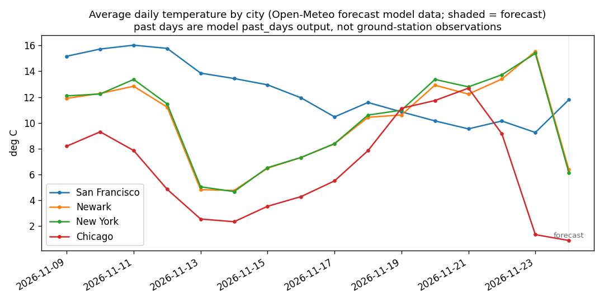

# Weather Warehouse - daily dashboard

Generated 2026-11-24 12:06 UTC.

| city | day | avg_temp_c | min_temp_c | max_temp_c | total_precip_mm | max_wind_kmh | hours_observed |
| --- | --- | --- | --- | --- | --- | --- | --- |
| Chicago | 2026-11-24 | 0.86 | -1.8 | 3.2 | 0.7 | 18.4 | 24 |
| New York | 2026-11-24 | 6.14 | 0.5 | 9.9 | 0.0 | 22.7 | 24 |
| Newark | 2026-11-24 | 6.37 | 0.8 | 10.0 | 0.0 | 23.7 | 24 |
| San Francisco | 2026-11-24 | 11.79 | 8.0 | 15.9 | 0.0 | 17.6 | 24 |
| Chicago | 2026-11-23 | 1.32 | -1.1 | 5.5 | 0.0 | 16.6 | 24 |
| New York | 2026-11-23 | 15.39 | 10.2 | 20.9 | 0.0 | 20.6 | 24 |
| Newark | 2026-11-23 | 15.54 | 10.5 | 21.5 | 0.0 | 20.2 | 24 |
| San Francisco | 2026-11-23 | 9.25 | 5.5 | 13.0 | 0.0 | 10.8 | 24 |
| Chicago | 2026-11-22 | 9.15 | 2.7 | 13.3 | 1.8 | 20.0 | 24 |
| New York | 2026-11-22 | 13.73 | 12.2 | 15.4 | 0.0 | 12.9 | 24 |
| Newark | 2026-11-22 | 13.4 | 11.3 | 15.5 | 0.0 | 11.5 | 24 |
| San Francisco | 2026-11-22 | 10.14 | 7.7 | 12.1 | 0.0 | 11.1 | 24 |
| Chicago | 2026-11-21 | 12.69 | 7.2 | 20.1 | 0.0 | 15.8 | 24 |
| New York | 2026-11-21 | 12.79 | 8.1 | 19.0 | 0.0 | 10.5 | 24 |
| Newark | 2026-11-21 | 12.23 | 6.7 | 19.2 | 0.0 | 13.0 | 24 |
| San Francisco | 2026-11-21 | 9.53 | 6.4 | 12.1 | 8.0 | 14.3 | 24 |
| Chicago | 2026-11-20 | 11.73 | 5.5 | 19.0 | 0.0 | 17.1 | 24 |
| New York | 2026-11-20 | 13.37 | 7.3 | 21.3 | 0.0 | 9.5 | 24 |
| Newark | 2026-11-20 | 12.92 | 5.6 | 21.7 | 0.0 | 11.2 | 24 |
| San Francisco | 2026-11-20 | 10.15 | 8.0 | 13.2 | 1.4 | 10.9 | 24 |
| Chicago | 2026-11-19 | 11.13 | 6.0 | 18.6 | 0.0 | 20.8 | 24 |
| New York | 2026-11-19 | 10.98 | 5.9 | 18.6 | 0.0 | 8.6 | 24 |
| Newark | 2026-11-19 | 10.61 | 3.7 | 19.9 | 0.0 | 9.1 | 24 |
| San Francisco | 2026-11-19 | 10.85 | 8.8 | 12.7 | 10.1 | 15.9 | 24 |
| Chicago | 2026-11-18 | 7.84 | 2.6 | 15.5 | 0.0 | 18.4 | 24 |
| New York | 2026-11-18 | 10.6 | 5.1 | 18.4 | 0.0 | 9.3 | 24 |
| Newark | 2026-11-18 | 10.43 | 3.1 | 19.3 | 0.0 | 10.5 | 24 |
| San Francisco | 2026-11-18 | 11.58 | 10.4 | 13.6 | 46.4 | 29.3 | 24 |
| Chicago | 2026-11-17 | 5.49 | 0.5 | 12.5 | 0.0 | 11.3 | 24 |
| New York | 2026-11-17 | 8.38 | 3.1 | 14.8 | 0.0 | 11.3 | 24 |

## Heat / cold exposure (current window)

Hours at or above 30C / at or below 0C and degree-hours beyond each threshold. Illustrative thresholds, not clinical guidance.

| city | heat hours | cold hours | heat degree-hours | cold degree-hours |
| --- | ---: | ---: | ---: | ---: |
| Chicago | 0 | 36 | 0.0 | 26.7 |
| New York | 0 | 0 | 0.0 | 0.0 |
| Newark | 0 | 0 | 0.0 | 0.0 |
| San Francisco | 0 | 0 | 0.0 | 0.0 |

## Unusual days

Completed days only: daily average temperature vs the city's other days (|z| >= 2). Informational: weather, not a data-quality failure.

| city | day | avg temp C | z-score |
| --- | --- | ---: | ---: |
| New York | 2026-11-14 | 4.66 | -2.14 |
| Newark | 2026-11-14 | 4.75 | -2.08 |
| Newark | 2026-11-13 | 4.81 | -2.05 |

## Precipitation

Model output in mm over the window; the current day includes forecast hours.

| city | total mm | wet days (>=1 mm) |
| --- | ---: | ---: |
| San Francisco | 95.8 | 8 |
| Newark | 34.7 | 2 |
| New York | 25.3 | 2 |
| Chicago | 19.2 | 5 |

## City leaders, 2026-11-23 (latest day complete in every city)

Model output, not station readings.

- Warmest high: Newark (21.5 C)
- Coldest low: Chicago (-1.1 C)
- Wettest: San Francisco (0.0 mm)
- Windiest: New York (20.6 km/h)

## Source freshness

Last successful Open-Meteo fetch per city (empty or failed fetches do not count). The latest hour is normally ahead of now because the feed includes forecast hours.

| City | Last successful fetch | Age (h) | Failed fetches since | Latest hour held |
| --- | --- | ---: | ---: | --- |
| Chicago | 2026-11-24 07:06:05.916490 | 0.0 | 0 | 2026-11-24 23:00:00 |
| New York | 2026-11-24 07:06:05.916490 | 0.0 | 0 | 2026-11-24 23:00:00 |
| Newark | 2026-11-24 07:06:05.916490 | 0.0 | 0 | 2026-11-24 23:00:00 |
| San Francisco | 2026-11-24 07:06:05.916490 | 0.0 | 0 | 2026-11-24 23:00:00 |

## Dry-day streaks (rain under 1 mm)

Consecutive completed days below 1 mm of rain. Model output; illustrative, not a drought measure.

| City | Current streak (days) | Longest streak (days) |
| --- | ---: | ---: |
| Chicago | 1 | 7 |
| New York | 10 | 10 |
| Newark | 10 | 10 |
| San Francisco | 2 | 4 |

## Warmest and coldest completed days

By daily average temperature, within the current data window only. Model output, not climate records.

| City | Warmest day | Avg C | Coldest day | Avg C | Days compared |
| --- | --- | ---: | --- | ---: | ---: |
| Chicago | 2026-11-21 | 12.69 | 2026-11-23 | 1.32 | 15 |
| New York | 2026-11-23 | 15.39 | 2026-11-14 | 4.66 | 15 |
| Newark | 2026-11-23 | 15.54 | 2026-11-14 | 4.75 | 15 |
| San Francisco | 2026-11-11 | 16.03 | 2026-11-23 | 9.25 | 15 |

## Week over week temperature

Mean daily average temperature, latest 7 completed days vs the 7 before. Two short windows, model output.

| City | Latest 7 days (C) | Previous 7 days (C) | Change (C) |
| --- | ---: | ---: | ---: |
| Chicago | 8.48 | 4.95 | +3.53 |
| New York | 12.18 | 8.66 | +3.52 |
| Newark | 11.93 | 8.53 | +3.40 |
| San Francisco | 10.28 | 14.25 | -3.97 |

## Degree days (base 18 C)

Heating degree days sum how far each completed day's average fell below 18 C; cooling degree days the reverse. Illustrative base, model output, current window only.

| City | Days | Heating degree days | Cooling degree days |
| --- | ---: | ---: | ---: |
| Chicago | 15 | 167.8 | 0.0 |
| New York | 15 | 112.1 | 0.0 |
| Newark | 15 | 114.9 | 0.0 |
| San Francisco | 15 | 83.1 | 0.0 |

## Severe-weather days

Daily rain >= 10 mm or wind >= 50 km/h. Illustrative thresholds, not official weather alerts. Values are Open-Meteo model output in mm and km/h per city-local day, not gauge observations; a day still in progress includes forecast hours.

| city | day | precip mm | max wind km/h | why | day status |
| --- | --- | ---: | ---: | --- | --- |
| San Francisco | 2026-11-19 | 10.1 | 15.9 | heavy rain | complete |
| San Francisco | 2026-11-18 | 46.4 | 29.3 | heavy rain | complete |
| Chicago | 2026-11-13 | 10.5 | 26.7 | heavy rain | complete |
| San Francisco | 2026-11-13 | 13.8 | 21.9 | heavy rain | complete |
| New York | 2026-11-12 | 21.7 | 24.5 | heavy rain | complete |
| Newark | 2026-11-12 | 31.3 | 30.1 | heavy rain | complete |

Data: [Open-Meteo](https://open-meteo.com/) hourly forecast API (past days are model `past_days` output, not observations).
